# Pixel Purse

**A spending tracker you log in plain language, with budgets as health bars.**
Type *"coffee CA$ 4 at tim hortons"* and it's filed under Food. Go over budget and it helps you cover it instead of shaming you. Built and shipped as a side project, from the first PRD to an app installed on my iPhone.

**[Try it live →](https://pixel-purse-two.vercel.app)** &nbsp;·&nbsp; On iPhone, open it in Safari and *Add to Home Screen*. To explore with sample history, tap **Get started**, then **Settings → Load demo data**.

<p align="center">
  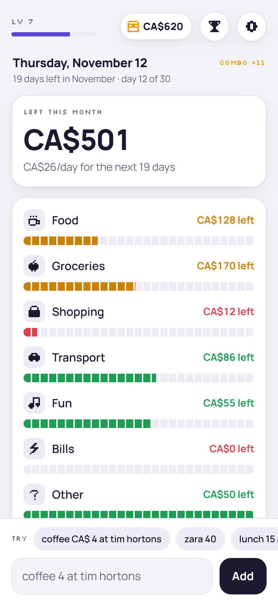
  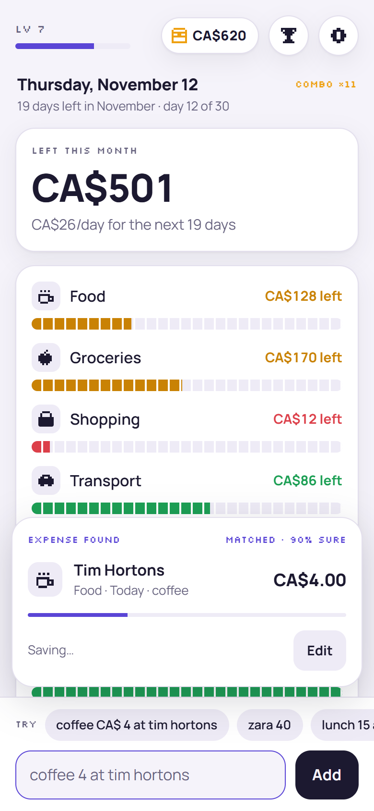
  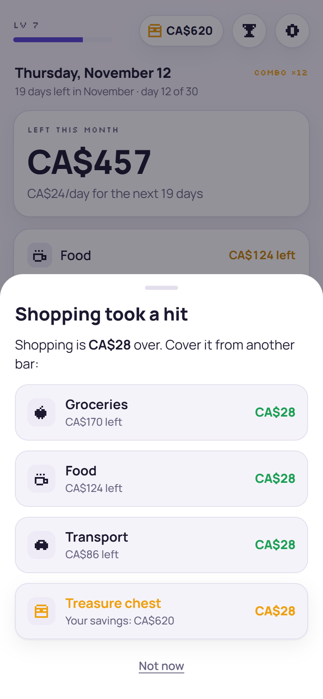
  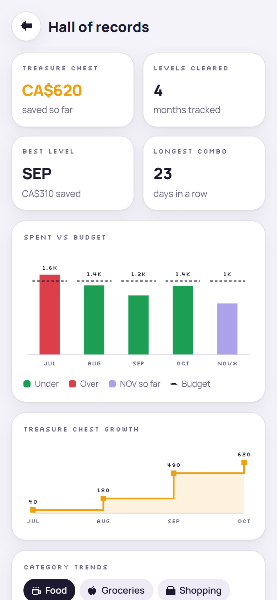
</p>

---

## The problem

Manual spending trackers work: typing in a purchase makes you notice it. But they're tedious, so most people quit within weeks. Bank-sync apps avoid the effort, but by the time they show you a purchase, it's already spent.

I wanted the awareness of manual logging with almost none of the effort, for two kinds of people:

- **Young professionals** on their first real salary who don't know where the money goes.
- **People paying off debt** who need tight limits, and who tend to give up after one bad week.

## What it does

| | |
|---|---|
| **Type it like you'd say it** | "lunch 15 and uber home 22" becomes two expenses in two categories. Claude parses it on the server, with a keyword matcher as an offline fallback. A confirmation card saves automatically after about 1.5 seconds, with Undo. |
| **Budgets as health bars** | Each category is a segmented HP bar that goes from green to amber to red. The main screen shows what's left this month and a daily pace ("CA$26/day for the next 19 days"). |
| **Over budget? Rebalance.** | When a bar goes over, you can cover it from the bar with the most left, or from savings. There's no "game over" anywhere. |
| **Month end** | A "Level complete" screen awards stars per category, moves leftovers into a savings treasure chest (or toward debt), and suggests **one** budget change for next month. |
| **It learns** | Correct a category once and that store is always filed there, without calling the AI again. |
| **Hall of records** | Charts of spending vs budget over time, treasure chest growth, trends per category and personal bests. |
| **A real iPhone app** | Installs to the Home Screen, opens full screen, works offline (expenses sync on reconnect), and sends daily reminders, skipped on days you've already logged. |
| **No sign-up wall** | You start as a guest. Your save file is upgraded in place when you add an email, using a 6-digit code rather than a password. |

<p align="center">
  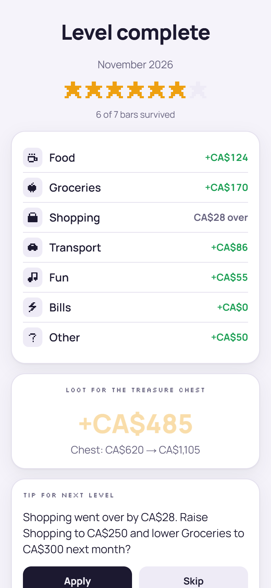
  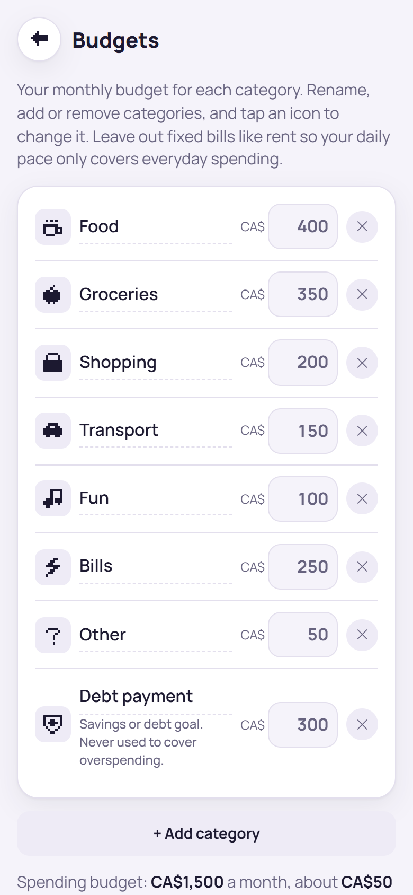
  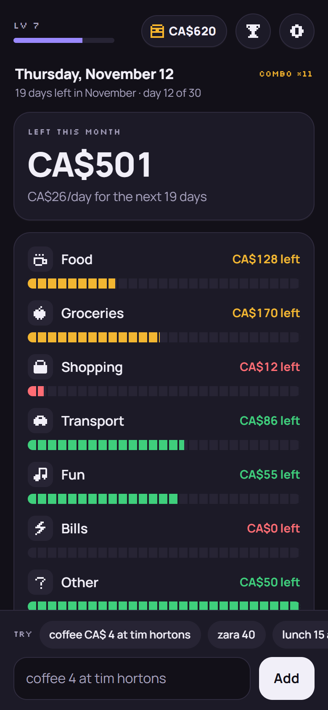
  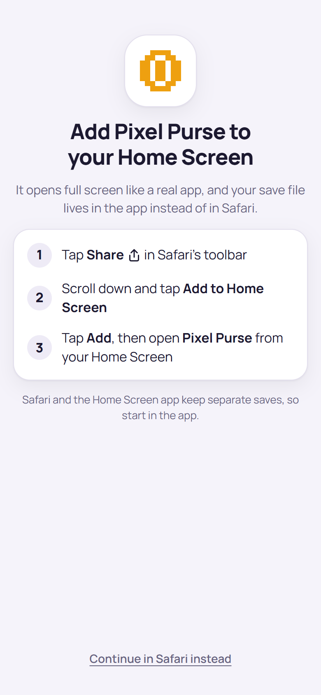
</p>

## Product decisions

The full reasoning is in the [PRD's decisions log](Plan/PRD.md#15-decisions-log). These are the ones that shaped the product most:

| Decision | Why |
|---|---|
| **Manual logging, no bank sync** | The moment you notice a purchase is the feature. Speed of entry became the requirement instead: **5 seconds or less** from opening the app. |
| **Plain-language entry with AI parsing** | A form is what makes manual trackers tedious. Typing a sentence is the fastest input on a phone, and iPhone dictation turns it into voice logging for free. |
| **Game mechanics, but never punishing** | Health bars, combos and levels make it worth opening. But the target users include people in debt, so overspending leads to a fix (rebalance) or a fresh start, never a "game over". |
| **Modern UI with pixel accents** | I prototyped a full retro-arcade look and a clean modern one. The arcade look was more distinctive but harder to read and less reassuring for money, so pixel art became the accent rather than the whole look. |
| **Guest first, sign in during onboarding** | An account protects data (Safari can wipe local storage) and caps AI costs per user. But a sign-up wall loses people, so you start as a guest and are asked to save after you've set up budgets. |
| **6-digit email codes, not magic links** | On iPhone, a magic link opens Safari, not the Home Screen app, so the sign-in lands in the wrong place. A code works wherever you are. |
| **Offline entries save immediately** | They're filed with keyword matching and synced on reconnect, rather than waiting in a queue for the AI. Logging never waits on the network. |
| **Editable categories (added after using it myself)** | Setting it up with my real budget showed that fixed bills like rent wrecked the daily pace. Being able to remove or rename categories fixed that, so this was built before the beta. |

## How I worked

1. **Problem and PRD.** I wrote the [PRD](Plan/PRD.md) covering personas, user stories with acceptance criteria, success metrics (north star: share of weekly active users who log on 4 or more days a week), risks and a phased release plan.
2. **Prototypes before code.** I built two clickable prototypes with different visual directions, tried them on my phone and picked one.

   <p>
     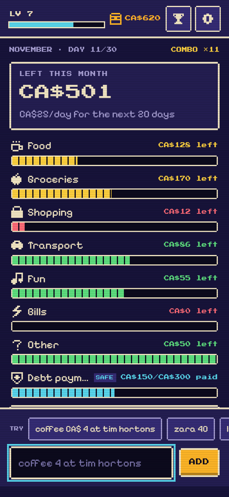
     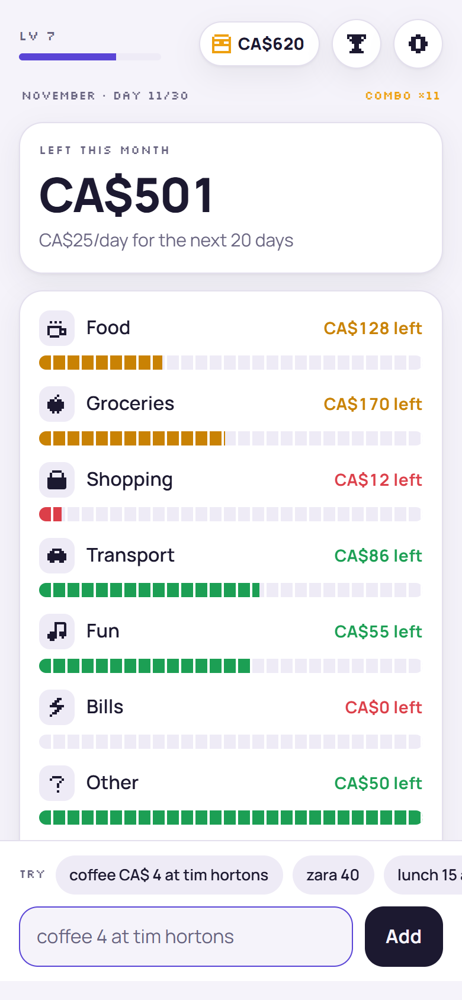
   </p>

   *Left: the full arcade look, which I rejected as harder to read. Right: modern with pixel accents, which I chose.*
3. **Detailed specs for the risky parts.** The [sign-in flow spec](Plan/sign-in-flow.md) covers every path and edge case, including the iPhone storage quirk that shaped it.
4. **Milestones you can demo.** The [build plan](Plan/build-plan.md) has five milestones, each ending in something usable on a phone: the core loop, then a full month, then accounts and sync, then the iPhone app, then beta.
5. **Use it, then adjust.** Running the app on my own budget surfaced the editable-categories gap, which went into the plan as a change before the beta.

I built it with [Claude Code](https://claude.com/claude-code) as a pair programmer. I owned the product decisions, specs and acceptance testing; Claude wrote most of the code from them.

## Architecture

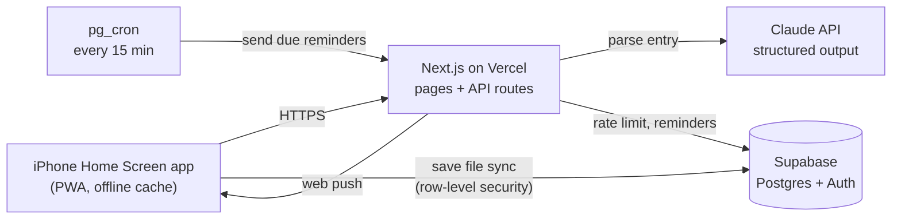

| Layer | Tech |
|---|---|
| App | Next.js 15 (App Router), React 19, TypeScript, Tailwind CSS |
| Data and auth | Supabase: Postgres with row-level security, anonymous guest accounts, email OTP |
| AI | Claude Opus 5.5 via `@anthropic-ai/sdk` (structured outputs, server-side only), with a rule-based fallback parser |
| iPhone app | Web app manifest, service worker (offline cache), Web Push with VAPID |
| Hosting | Vercel (deploys on every push to `main`); Resend for email |

**Security and cost controls:** row-level security, so each user can only read or write their own rows (tested by trying to write another user's save). API keys stay on the server. There's a limit of 100 AI parses per user per day. Scheduled jobs need a shared secret. Deleting an account removes everything, with a CSV export offered first.

## Quality

- **33 unit tests** (Vitest) for the parser (every example in the PRD), budget math, month end, category editing and CSV export.
- **6 browser test suites** (Playwright driving Edge at iPhone size), run against the live site: the new-player flow, editing budgets, install guide, offline mode, delete account and reminders.
- Tested on a real iPhone: installing, signing in with a code, logging, Airplane mode and syncing back.

## Repo map

```
Plan/            PRD, sign-in flow spec, build plan
web/             the app (Next.js)
  src/lib/domain    budget math, month end, categories (pure, unit-tested)
  src/lib/parse     Claude parser + rule-based fallback
  src/lib/store     local save file + Supabase sync
  supabase/         database migrations (tables, security rules, functions)
  e2e/              browser tests
docs/screenshots/ the images in this README
```

To run it locally, see [web/README.md](web/README.md).

## What's next

Before inviting about 10 beta testers: real AI parsing measured on 100 real entries (target 95% accuracy), my own email domain so sign-in codes reach anyone, and analytics for the PRD's success metrics. After the beta: Google sign-in, receipt scanning and recurring expenses.
